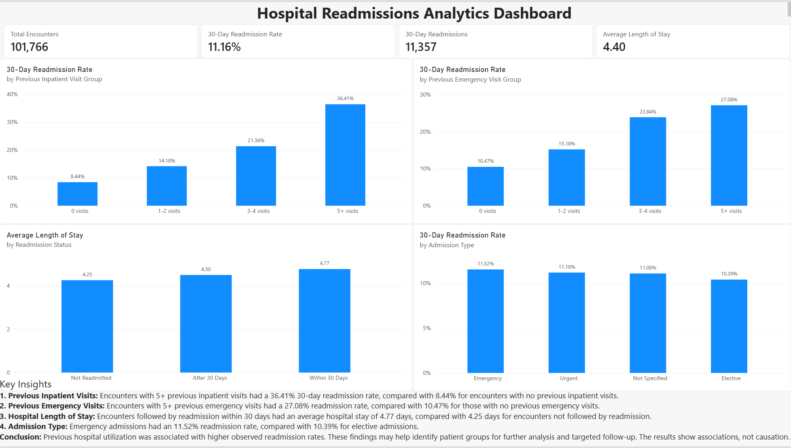

# Hospital Readmissions Analytics Dashboard

## Project Overview
This healthcare analytics project analyzes 101,766 hospital encounters involving patients with diabetes to identify factors associated with 30-day hospital readmissions. The project uses SQL Server for data analysis and Power BI for interactive data visualization.

## Project Objectives
- Analyze hospital readmission rates.
- Identify patient groups with higher observed readmission rates.
- Evaluate the relationship between previous hospital visits and readmissions.
- Examine hospital length of stay and admission types.
- Develop an interactive healthcare analytics dashboard.

## Tools & Technologies
- Microsoft SQL Server
- SQL Server Management Studio (SSMS)
- Microsoft Power BI
- SQL
- DAX
- CSV datasets

## Dataset

- **Source:** UCI Machine Learning Repository
- **Dataset:** Diabetes 130-US Hospitals for Years 1999–2008
- **Total Records:** 101,766 hospital encounters
- **Time Period:** 1999–2008
- **License:** Creative Commons Attribution 4.0 (CC BY 4.0)
- **Authors:** Beata Strack et al.

[View Original Dataset](https://doi.org/10.24432/C5230J)

This publicly available dataset was used for educational
and portfolio purposes.

## Key Findings
- Encounters with five or more previous inpatient visits had a 36.41% readmission rate, compared with 8.44% for those with no previous inpatient visits.
- Encounters with five or more previous emergency visits had a 27.08% readmission rate, compared with 10.47% for those with no previous emergency visits.
- Encounters followed by readmission within 30 days had an average hospital stay of 4.77 days, compared with 4.25 days for encounters not followed by readmission.
- Emergency admissions had an 11.52% readmission rate, compared with 10.39% for elective admissions.

## Dashboard
The Power BI dashboard includes four KPI cards and visualizations analyzing previous inpatient visits, emergency visits, hospital length of stay, and selected admission types.

## Skills Demonstrated
- SQL querying and data aggregation
- Exploratory data analysis
- Database management
- Conditional logic using CASE statements
- DAX measures and calculated columns
- KPI development
- Data visualization
- Healthcare data interpretation

## Limitations
The dataset contains historical hospital encounters. The findings represent observed associations rather than causal relationships. The readmission rate is calculated using all encounters in the dataset and is not a risk-adjusted clinical quality measure.

## Conclusion
Previous hospital utilization was associated with higher observed readmission rates. These findings highlight patient groups that may benefit from further investigation and targeted follow-up.
